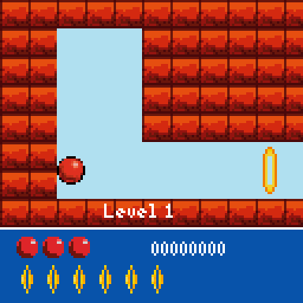
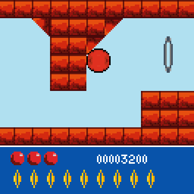
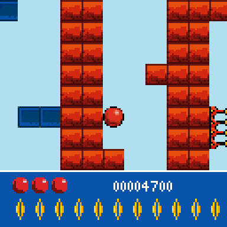
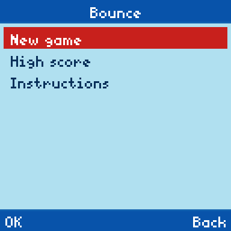

# Bounce RE

A native Windows, Linux and macOS port of **Bounce**, the 2002 Nokia J2ME game. Roll
and bounce a red ball through 11 levels, pass through every hoop to open the
exit, and watch out for spikes. Inflators make the ball big enough to float
in water; deflators shrink it back.

The original game was decompiled and every class rewritten in Rust ("RE" as
in reverse-engineered), so no Java runtime or emulator is involved. SDL3
handles the window, keyboard, gamepads, rumble and sound.

| | | | |
| :-: | :-: | :-: | :-: |
|  |  |  |  |

## How to play

You need your own copy of the original game: **`Bounce.jar`**, the Nokia
128x128 release, version 1.9 (56,375 bytes, SHA-256
`3fad7bc2b82e7ddeaffbbb205a239897b1380829abc557c7ae6909a0245179c6`). It isn't
included here or in the releases.

1. Download your system's build from
   [Releases](https://github.com/Xarishark/bounce-re/releases)
   (`BounceRE-v…-Windows-x64.zip`, `-Linux-x64.tar.gz` or `-macOS-arm64.zip`)
   and unpack it somewhere you can write to (not Program Files).
2. Run `Bounce.exe` (`bounce` on Linux and macOS; the Mac build isn't
   signed, so the first time right-click it and choose Open). On the first
   start it asks for the JAR: drop it on the window, or press Fire / A
   (Cross) to pick it. (A JAR placed next to the program, or
   `--game <path>`, works too.)
3. The game checks the file and unpacks its art, levels, sounds and text
   into `data/`. From then on it starts straight into the game.

### RecompLauncher

Bounce RE supports [RecompLauncher](https://recomplauncher.com) fully
(`recomplauncher.json`, levels 1 to 3): the launcher installs and updates it
from this repo's releases, asks for your JAR on its setup screen and
unpacks it with the game's own setup step, shows the settings on the
game's page, backs up your saves, and attaches the log to crash reports.
Big Picture mode starts the game full screen, and button hints follow the
controller type the launcher reports.

## Controls

| Action | Keyboard | Gamepad |
| --- | --- | --- |
| Roll left / right | Left / Right, A / D, keypad 4 / 6 | D-pad, left stick, LB / RB |
| Jump | Up, W, Space, keypad 2 | A, X, right trigger, D-pad up |
| Menu (pause) | Esc, Tab | B, Start, Y, Back |
| Menus: move / select | Up / Down, Enter | D-pad, A |
| Phone keypad (cheat codes) | 0-9 | |
| Full screen | F, F11, Alt+Enter | |
| Mute / volume | M, + / - | |

In the main menu, Back (Esc / B) quits; your game is saved and "Continue"
picks it up next time.

## Files and settings

Everything stays in the game's folder, so the whole folder is portable:

| | |
| --- | --- |
| `save/` | the saved game, best level and high score (`bounceRMS.rms`, the original format) |
| `data/` | the art, levels, sounds and text unpacked from your JAR |
| `settings.toml` | window size, full screen, scaling, sound, rumble, language (commented) |
| `logs/` | `bounce.log` from the last three runs |

If the folder can't be written, the game shows an error and stops instead of
saving somewhere else.

Command line options (they override `settings.toml`): `--game <jar>`,
`--scale N`, `--fullscreen`, `--mute`, `--no-rumble`, `--lang xx|tl-PH`.
`--help` lists everything.

## Differences from the phone version

The game logic is the original's, line for line: the same 30 ms game tick,
physics, collision, scrolling and levels. A few things changed for a PC:

- **Jump on Fire too.** Space, Enter and the A button jump as well as Up.
- **Held keys survive a respawn.** The phone only reported key presses, so
  after losing a life the new ball ignored a key you were still holding.
- **No "Continue" into a lost game.** Quitting after a game over saved the
  dead game as resumable (with -1 lives); now it's saved as finished.
- **Minimising the window** pauses to the menu, the way an incoming call
  did on the phone. Losing a life rumbles the gamepad.
- **Sound** is the phone's three ringtone beeps (hoop, pickup, pop),
  decoded from the JAR's Smart Messaging tones and played as square waves.
- The menus are drawn in the game's colours instead of the phone's theme.
  Vietnamese and Chinese text from the JAR isn't offered (the pixel font has
  no glyphs for them).

## Building

A recent stable Rust toolchain and CMake. SDL3 is built from source and
linked statically, so the program needs nothing else installed. Building
doesn't need the game; running it does. On Linux, install the X11, Wayland
and audio development headers SDL uses (the list is in
`.github/workflows/build.yml`), then:

```bash
cargo build --release
```

Release archives come from `tools/package-release.sh windows|linux|macos`.
The Windows `.exe` is cross-compiled from Linux with MinGW (`mingw64-gcc`):

```bash
rustup target add x86_64-pc-windows-gnu
tools/package-release.sh windows   # dist/BounceRE-v<version>-Windows-x64.zip
```

CI builds all three on every push and pull request; pushing a `v*` tag
publishes them as a GitHub release.

`tools/run-tests.sh` plays the game headless with the scripts in
`tests/scripts/` and saves screenshots; it needs your JAR in `game-files/`
(git-ignored) or `BOUNCE_JAR`. See [docs/PORTING.md](docs/PORTING.md) for
how the port is organized.

## Credits and copyright

Bounce (2002) lists its vendor as **ANDREW-LVIV / Nokia**. All rights to the
original game, its name, artwork, sounds and text belong to their respective
owners. The screenshots show the
port running. Players supply their own JAR.

This project is not affiliated with or endorsed by Nokia or ANDREW-LVIV.
The port's source code is released under the [MIT License](LICENSE).
